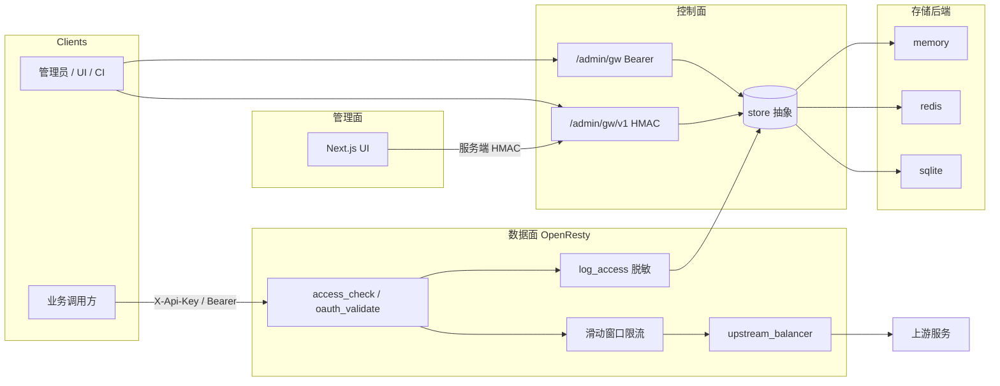

# mini-gateway

OpenResty 上的轻量级 API 网关：**鉴权、滑动窗口限流、IP 白名单、可配置上游、管理 API 与 Web UI**。适合学习或小团队 MVP；详细路线图见 [to-do-list-zh-CN.md](./to-do-list-zh-CN.md)。

---

## 架构



| 面 | 职责 | 仓库落点 |
|----|------|----------|
| 数据面 | 转发、鉴权、限流 | `nginx/lua/access_check.lua`、`oauth_validate.lua` |
| 控制面 | Key / 白名单 CRUD | `admin_api.lua`、`admin_api_v1.lua`、`store/*` |
| 管理面 | 控制台 | `ui/` |
| 观测面 | 访问日志、Request ID | `log_access.lua`（凭证脱敏） |

---

## 能力矩阵（当前 MVP）

| 能力 | 状态 |
|------|------|
| API Key + OAuth2 JWT（HS256/RS256） | ✅ |
| 滑动窗口限流、按 Key 配额 | ✅ |
| 业务 / 管理 IP 白名单 | ✅ |
| 存储 memory / redis / sqlite | ✅ |
| 管理 v0 Bearer + v1 HMAC（**统一 store**） | ✅ |
| 上游多 peer 健康检查与负载均衡 | ✅ |
| `/health`、`/ready` | ✅ |
| Web 管理台（全存储模式） | ✅ |
| 访问日志 api_key / subject **脱敏** | ✅ |
| Prometheus `GET /metrics` | ✅ |
| 存储 **错误率熔断**（半开）+ `pass`/`reject` 降级 | ✅ env 可配 |
| 管理操作 **审计**（`audit_list`） | ✅ |
| shared_dict **配置缓存** | ✅ `GATEWAY_CONFIG_CACHE` |
| 多维度 / 路由 / 全局限流、URI·UA 拦截、日志采样 | ✅ P2 env + admin |
| 灰度标头（`X-Gray-Tag`）、配置快照 | ✅ P3 基础 |
| Header 改写、RBAC、WebSocket/AI 等 | ❌ P3+/P4 |

契约与示例：[postman/](./postman/) · 运维手册：[operation-doc.md](./operation-doc.md)

---

## 存储选型

| 模式 | 适用场景 | 持久化 | 管理 UI |
|------|----------|--------|---------|
| **memory**（默认） | 本地开发、单测、无外部依赖 | 容器重建后丢失 | ✅ v1 HMAC |
| **sqlite** | 单机小部署、演示落盘 | `./data/gateway.db` | ✅ |
| **redis** | 与现有 Redis 运维体系一致、多副本共享配置 | Redis AOF/RDB | ✅ |

```bash
GATEWAY_STORAGE=memory ./start.sh
GATEWAY_STORAGE=sqlite ./start.sh    # 需 openresty/Dockerfile 含 lsqlite3
GATEWAY_STORAGE=redis ./start.sh     # 或 ./start-redis.sh + ./start-gateway.sh
```

Bootstrap 默认凭证：**API Key** `mini-key` · **Admin Bearer** `mini-token` · **HMAC Secret** `admin-secret-2026`（见 `.env.example`）。

---

## 快速启动

```bash
cd mini-gateway
cp .env.example .env   # 可选

./start.sh                              # memory 网关（8080）
./start-ui.sh                           # 管理 UI（3000，profile ui）
./start-all.sh                          # redis + 网关 + UI 全栈

# 管理台本地开发
cp ui/.env.example ui/.env.local
cd ui && npm install && npm run dev
```

Docker 服务：`gw-openresty`（8080）、可选 `gw-redis`（6379）、可选 `gw-ui`（3000）。端口见 `.env` 中 `GATEWAY_PORT` / `UI_PORT` / `REDIS_PORT`。

### 探活

```bash
curl -s http://127.0.0.1:8080/health
curl -s http://127.0.0.1:8080/ready
curl -s http://127.0.0.1:8080/metrics | head
```

存储熔断（`GATEWAY_STORAGE_CB_*`）默认 **10s 窗口、50% 错误率、最少 5 次采样** 后打开；冷却 **30s** 进入半开。降级策略 `GATEWAY_STORAGE_CB_POLICY=pass|reject`（兼容旧名 `GATEWAY_CIRCUIT_BREAK_POLICY`）。响应头 `X-Storage-Circuit-State`：`closed` / `open` / `half_open`。

### 业务流量（原样转发路径）

```bash
curl -i -H "X-Api-Key: mini-key" http://127.0.0.1:8080/get
```

默认透传客户端 URI；固定上游路径时设置 `GATEWAY_UPSTREAM_PATH`（见 [operation-doc.md](./operation-doc.md)）。

### 自动化测试

```bash
python3 test/test_log_redact.py   # 脱敏规则（无网关）
python3 test/test_hmac.py         # 需网关 listening :8080
python3 test/test_oauth2.py       # 网关须 GATEWAY_AUTH_MODE=bearer|both
```

**与 GitHub Actions 一致的本地冒烟**（集群内 `mock-upstream`，不依赖外网 httpbin）：

```bash
./scripts/ci-smoke.sh          # 全量：含数据面预检 + OAuth E2E
./scripts/ci-smoke-lite.sh     # 轻量：跳过数据面预检与 bearer 200（控制面 + 401 用例）
./scripts/ci-stack-up.sh       # 仅起栈
./scripts/ci-stack-down.sh     # 销毁 ci 栈
```

轻量 / 绕过数据面预检（容器已健康但 `GET /` 仍非 200 时）：

```bash
CI_STACK_SKIP_DATA_PLANE_PREFLIGHT=1 ./scripts/ci-stack-up.sh
CI_SMOKE_LITE=1 python3 test/test_hmac.py   # 仍需 :8080
```

无 Docker 时只能跑 `python3 test/test_log_redact.py`。

日常 `./start.sh` 仍默认 **httpbin 上游**；`mock-upstream` 在 `docker-compose.yml` 中**无 profile**（保证 `docker-compose.ci.yml` 的 `depends_on` 可解析），但**不会**被 `start.sh` 自动拉起。

CI：GitHub Actions [`.github/workflows/ci.yml`](./.github/workflows/ci.yml) 调用 `scripts/ci-stack-up.sh`（与 `ci-smoke.sh` 同源）。

---

## 运维与安全

- 访问日志字段 `api_key`、`auth_subject` 经 `log_redact.lua` 打码（形如 `mini***-key`），**不落盘完整密钥**。
- 管理 v0 `token_list` 仅返回 **脱敏 token** 与元数据；吊销仍使用颁发时返回的完整 token（`token_revoke`）。
- Docker 内 UI 调用 v1 时，默认 `GATEWAY_ADMIN_TRUST_PRIVATE=1` 信任私网段；生产请收紧 `admin:whitelist:ip`。

---

## 文档索引

| 文档 | 用途 |
|------|------|
| [operation-doc.md](./operation-doc.md) | curl / OAuth / HMAC 手册 |
| [to-do-list-zh-CN.md](./to-do-list-zh-CN.md) | MVP / P1–P4 路线图 |
| [develop-design.md](./develop-design.md) | P2+ 详细设计参考 |
| [ui/README.md](./ui/README.md) | 管理台环境变量与部署 |

---

## 常见问题

### Redis 镜像拉取失败（DaoCloud mirror 超时）

Docker Desktop → **Settings → Docker Engine** 检查 `registry-mirrors`；或先 `docker pull redis:7-alpine` 再 `./start-redis.sh`。Compose 使用 `pull_policy: if_not_present`。

### OpenResty 实现提示

1. 鉴权限流放在 `access_by_lua`；老版本勿在 rewrite 里用 Redis cosocket。
2. Redis 客户端须 `set_keepalive` 连接池化。
3. `ngx.var.http_*` 为小写：`X-Api-Key` → `http_x_api_key`。
4. 压测用 API Key 限流维度，避免单 IP 过早 429。
5. cosocket 超时防止慢 Redis 拖死 worker。

---

## License

See [LICENSE](./LICENSE).