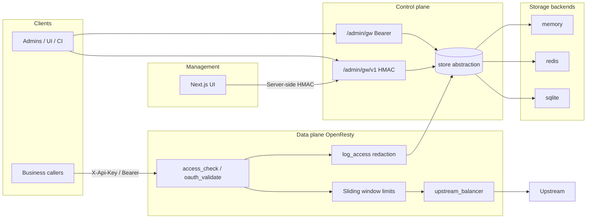

# mini-gateway

**English (default)** · [简体中文](./README.zh-CN.md)

A lightweight API gateway on OpenResty: **auth, sliding-window rate limits, IP allowlists, configurable upstreams, admin API, and web UI**. Good for learning or small-team MVPs. See the roadmap in [to-do-list.en.md](./to-do-list.en.md).

---

## Architecture



| Plane | Role | Code |
|-------|------|------|
| Data | Proxy, auth, rate limits | `nginx/lua/access_check.lua`, `oauth_validate.lua` |
| Control | Key / allowlist CRUD | `admin_api.lua`, `admin_api_v1.lua`, `store/*` |
| Management | Console | `ui/` |
| Observability | Access logs, request ID | `log_access.lua` (credential redaction) |

---

## Capability matrix (current MVP)

| Capability | Status |
|------------|--------|
| API Key + OAuth2 JWT (HS256/RS256) | ✅ |
| Sliding-window limits, per-key quotas | ✅ |
| Business / admin IP allowlists | ✅ |
| Storage: memory / redis / sqlite | ✅ |
| Admin v0 Bearer + v1 HMAC (**shared store**) | ✅ |
| Multi-peer upstream health checks & LB | ✅ |
| `/health`, `/ready` | ✅ |
| Web admin UI (all storage modes) | ✅ |
| Access log api_key / subject **redaction** | ✅ |
| Prometheus `GET /metrics` | ✅ |
| Storage **error-rate circuit breaker** (half-open) + `pass`/`reject` | ✅ env |
| Admin **audit** (`audit_list`) | ✅ |
| shared_dict **config cache** | ✅ `GATEWAY_CONFIG_CACHE` |
| Multi-dim / route / global limits, URI·UA blocks, log sampling | ✅ P2 env + admin |
| Canary headers, config snapshots, Header/URI rewrite, Admin RBAC | ✅ P3 |
| Developer guide | ✅ `docs/developer-portal.md` |
| Business HMAC, quota warm-up, leaky-bucket limits | ✅ P4 basics |
| Admin UI: audit / RBAC / URI policy | ✅ Governance tab |
| Error-log credential scrub | ✅ `gateway_log` |
| CI storage matrix memory/sqlite/redis | ✅ |
| WebSocket / bandwidth / AI / true multi-upstream canary | ❌ see to-do |

Contracts & examples: [postman/](./postman/) · Operations: [operation-doc.md](./operation-doc.md)

---

## Storage guide

| Mode | Use case | Durability | Admin UI |
|------|----------|------------|----------|
| **memory** (default) | Local dev, unit tests, no deps | Lost on container recreate | ✅ v1 HMAC |
| **sqlite** | Single-node, demo persistence | `./data/gateway.db` | ✅ |
| **redis** | Shared config across replicas | Redis AOF/RDB | ✅ |

```bash
GATEWAY_STORAGE=memory ./start.sh
GATEWAY_STORAGE=sqlite ./start.sh    # OpenResty image needs lsqlite3
GATEWAY_STORAGE=redis ./start.sh     # or ./start-redis.sh + ./start-gateway.sh
```

Bootstrap defaults: **API Key** `mini-key` · **Admin Bearer** `mini-token` · **HMAC Secret** `admin-secret-2026` (see `.env.example`).

---

## Quick start

```bash
cd mini-gateway
cp .env.example .env   # optional

./start.sh                              # memory gateway (:8080)
./start-ui.sh                           # admin UI (:3000, profile ui)
./start-all.sh                          # redis + gateway + UI

# Local UI dev
cp ui/.env.example ui/.env.local
cd ui && npm install && npm run dev
```

Docker services: `gw-openresty` (8080), optional `gw-redis` (6379), optional `gw-ui` (3000). Ports: `GATEWAY_PORT` / `UI_PORT` / `REDIS_PORT` in `.env`.

### Health checks

```bash
curl -s http://127.0.0.1:8080/health
curl -s http://127.0.0.1:8080/ready
curl -s http://127.0.0.1:8080/metrics | head
```

Storage circuit breaker (`GATEWAY_STORAGE_CB_*`): default **10s window, 50% error rate, min 5 samples** before open; **30s** cooldown to half-open. Policy `GATEWAY_STORAGE_CB_POLICY=pass|reject` (legacy `GATEWAY_CIRCUIT_BREAK_POLICY`). Header `X-Storage-Circuit-State`: `closed` / `open` / `half_open`.

### Business traffic (path passthrough)

```bash
curl -i -H "X-Api-Key: mini-key" http://127.0.0.1:8080/get
```

Client URI is forwarded as-is by default; set `GATEWAY_UPSTREAM_PATH` for a fixed upstream path (see [operation-doc.md](./operation-doc.md)).

### Automated tests

```bash
python3 test/test_log_redact.py   # redaction rules (no gateway)
python3 test/test_hmac.py         # gateway on :8080
python3 test/test_oauth2.py       # GATEWAY_AUTH_MODE=bearer|both
```

**Local smoke aligned with GitHub Actions** (in-cluster `mock-upstream`, no public httpbin):

```bash
./scripts/ci-smoke.sh          # full: data-plane preflight + OAuth E2E
./scripts/ci-smoke-lite.sh     # lite: skip data-plane preflight & bearer 200
./scripts/ci-stack-up.sh       # start stack only
./scripts/ci-stack-down.sh     # tear down ci stack
```

Lite / skip data-plane preflight when containers are healthy but `GET /` ≠ 200:

```bash
CI_STACK_SKIP_DATA_PLANE_PREFLIGHT=1 ./scripts/ci-stack-up.sh
CI_SMOKE_LITE=1 python3 test/test_hmac.py   # still needs :8080
```

Without Docker, only `python3 test/test_log_redact.py` runs offline.

Daily `./start.sh` still defaults to **httpbin** upstream; `mock-upstream` has **no profile** in `docker-compose.yml` (so `docker-compose.ci.yml` `depends_on` resolves) but is **not** started by `./start.sh`.

CI: GitHub Actions [`.github/workflows/ci.yml`](./.github/workflows/ci.yml) uses `scripts/ci-stack-up.sh` (same source as `ci-smoke.sh`).

---

## Operations & security

- Access logs redact `api_key` and `auth_subject` via `log_redact.lua` (e.g. `mini***-key`); **full secrets are not persisted**.
- Admin v0 `token_list` returns **masked tokens** and metadata only; revoke with the full token from `token_issue` (`token_revoke`).
- Docker UI calls v1 with default `GATEWAY_ADMIN_TRUST_PRIVATE=1` for RFC1918; tighten `admin:whitelist:ip` in production.

---

## Documentation

| Doc | Purpose |
|-----|---------|
| [README.md](./README.md) / [README.zh-CN.md](./README.zh-CN.md) | Project overview (EN / ZH) |
| [operation-doc.md](./operation-doc.md) | curl / OAuth / HMAC cookbook |
| [to-do-list.en.md](./to-do-list.en.md) / [to-do-list-zh-CN.md](./to-do-list-zh-CN.md) | MVP / P1–P4 roadmap |
| [develop-design.md](./develop-design.md) | P2+ design notes |
| [ui/README.md](./ui/README.md) / [ui/README.zh-CN.md](./ui/README.zh-CN.md) | Admin UI env & deploy |

---

## FAQ

### Redis image pull fails (mirror timeout)

Check `registry-mirrors` in Docker Desktop → **Settings → Docker Engine**, or `docker pull redis:7-alpine` then `./start-redis.sh`. Compose uses `pull_policy: if_not_present`.

### OpenResty notes

1. Auth and limits in `access_by_lua`; avoid Redis cosocket in rewrite on older builds.
2. Pool Redis with `set_keepalive`.
3. `ngx.var.http_*` is lowercase: `X-Api-Key` → `http_x_api_key`.
4. Load-test with API Key limits, not single-IP limits, to avoid early 429s.
5. Set cosocket timeouts so slow Redis does not stall workers.

---

## License

See [LICENSE](./LICENSE).